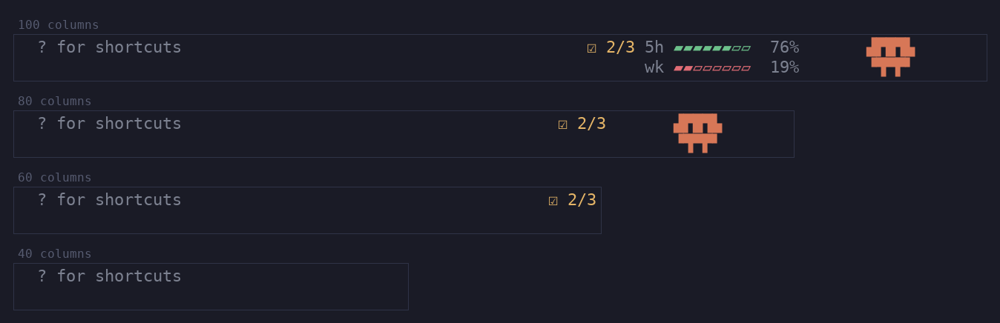

# Bermudamon

Bermuda ships one Claude Code mod, [`mods/bermudamon`](../mods/bermudamon/README.md):
a pet in the prompt footer that follows your work and your bermuda checklist.

```
/plugin marketplace add bon5co/bermuda
/plugin install bermudamon@bermuda
```



The repository root carries `.claude-plugin/marketplace.json`, which is how
Claude Code finds the mod; `herdr plugin install` and `go install` do not touch
it. It reads the same store the `bermuda` command does, so install the command
too ([Install](../README.md#install)) for the checklist part to work.
